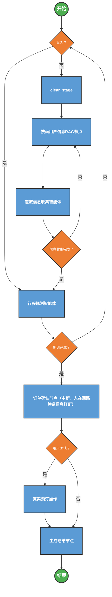

# 差旅规划Agent系统

## 总体系统功能概览

| 功能模块 | 核心能力 | 详细说明 |
| :--- | :--- | :--- |
| **🗣️ 智能对话交互** | 自然语言理解 | 无需填写复杂表单，直接通过聊天告知出行需求（如："下周三去北京出差三天"）。 |
| | 多轮追问 | 自动识别缺失信息（如忘记说具体时间或交通偏好），并温和地进行追问补全。 |
| **👤 个性化信息集成** | 自动档案匹配 | 自动关联企业内部档案（职级、身份证、手机号），无需重复输入个人敏感信息。 |
| | 差标管控 | 根据您的职级自动匹配公司差旅标准（如：是否可坐商务座、酒店预算上限），超标自动预警。 |
| **✈️ 多模态交通规划** | 实时票务查询 | 直连 **12306** 和 **航司** 接口，提供实时的余票、航班动态查询。 |
| | 智能方案推荐 | 综合考量价格、耗时、出发时间，为您推荐最优的 2-3 套 "去程+返程" 组合方案。 |
| | 自主任务管理 | 智能拆解复杂规划任务（任务列表），动态管理待办清单，确保流程不遗漏。 |
| **🏨 住宿智能推荐** | 精准选址 | 结合您的办事地点，基于地图距离和通勤时间推荐最便利的酒店。 |
| | 协议价优先 | 优先展示公司协议酒店，帮您节省预算。 |
| **🗺️ 智能行程助手** | 交互式地图 | 生成包含酒店、办事地点、机场/车站的交互式地图，一键导航。 |
| | 接驳规划 | 自动规划 "机场/车站 ↔ 酒店 ↔ 办事地" 之间的打车或公共交通接驳路线。 |
| **📋 最终方案确认** | 结构化行程单 | 输出包含时间轴、航班号、酒店地址、联系方式的完整行程单，一目了然。 |
| | 人在回路 (HITL) | 关键敏感操作（如：下单支付、敏感信息修改）必须经由人工确认，系统中断等待用户指令。 |
| | 一键预订 | (开发中) 确认方案后，支持一键完成所有资源的真实预订下单。 |


## 总体流程图



---

## 1. 核心架构与工作流

定义：一个状态驱动的多智能体差旅规划系统。通过分步交互方式收集用户信息，并调用外部服务实时查询交通、住宿和地图数据，最终生成差旅方案。

### 主要节点功能

| 节点 | 类型 | 功能描述 |
|------|------|---------|
| `clear_stage` | 普通代码节点 | 判断用户意图：是切换账号/身份还是仅修改信息。切换账号则清空全部状态，修改信息则仅清空相关字段。 |
| `search_user_info` | 普通代码节点 | 调用外部系统（如ERP）获取用户的身份证、电话、职级、报销标准等静态信息，用于个性化规划。 |
| `info_collection` | 自主式智能体节点 | 收集用户出行所需的动态信息（出发地、目的地、时间等），使用工具持续检查完整性，直至所有字段补全。 |
| `itinerary_planner` | 自主式智能体节点 | 核心规划节点，按步骤调用MCP服务进行交通、住宿、路线规划，确保每一步均需用户确认。 |
| `order_confirmation` | 普通代码节点 | 在规划完成后中断流程，等待用户“确认”或“取消”，实现人在回路控制。 |
| `order_operation` | 普通代码节点 | 用户确认后，真实调用预订接口下单。 |
| `summary` | LLM调用节点 | 综合上下文与状态记忆，生成结构化的行程单及交互式地图链接。 |

---

## 2. 记忆机制

### 2.1 短期记忆

即传给LLM API的上下文，以 `messages` 数组传入，包含当前对话历史与临时决策信息。

示例：
```json
{ 
    "messages": [
        {
            "role": "user",
            "content": "我要从北京到上海，出发日期是2025年1月1日，返回日期是2025年1月5日。"
        },
        {
            "role": "assistant",
            "content": "好的，收到。请问您这次出行的交通方式有偏好吗？比如高铁还是飞机？另外，您对住宿有什么要求？"
        },
        {
            "role": "user",
            "content": "优先高铁，住宿在市中心，预算500以内。"
        },
        {
            "role": "assistant",
            "content": "好的，我会根据您的要求进行规划。您需要查询哪些信息？"
        }
    ]
}

```

### 2.2 中期记忆（状态记忆）

整个图共享一个状态实例，用于在节点间传递数据。其结构如下：

以下是 `AgentState` 及其嵌套结构 `UserInfo` 的状态定义表格：

### 🗂️ AgentState 状态定义表

| 字段名 | 类型 | 描述 | 更新策略 |
| :--- | :--- | :--- | :--- |
| **`messages`** | `List[BaseMessage]` | 存储对话历史消息列表（System/Human/AI/Tool Message）。 | **增量追加** (`operator.add`) <br> 新消息会追加到现有列表末尾，保留完整上下文。 |
| **`userInfo`** | `Optional[UserInfo]` | 存储用户的结构化差旅信息（见下方 UserInfo 详情）。 | **覆盖更新** <br> 每次提取到新信息时更新对应字段。 |
| **`todos`** | `list[dict]` | 待办事项列表，用于驱动行程规划的步骤（如：订票→订酒店→规划路线）。 | **全量/增量更新** <br> 记录任务状态（pending/in_progress/completed）。 |
| **`stage`** | `str` | 当前所处的流程阶段标识。 <br> 例：`"信息收集"`, `"行程规划"`, `"订单确认"`。 | **覆盖更新** <br> 用于前端显示进度条或后端路由判断。 |
| **`final_planning_result`** | `Optional[str]` | 最终生成的完整行程规划方案文本。 | **覆盖更新** <br> 规划完成后生成，供用户确认。 |
| **`final_planning_confirmed`** | `Optional[bool]` | 标记用户是否已确认最终方案。 | **覆盖更新** <br> `True` 表示已确认，流程可向下流转。 |

---

### 👤 UserInfo 结构详情 (嵌套在 `userInfo` 字段中)

| 字段名 | 类型 | 含义 | 必填性 |
| :--- | :--- | :--- | :--- |
| `username` | `str` | 姓名 | ⚪ 可选 |
| `phone` | `str` | 电话号码 | ⚪ 可选 |
| `id_card` | `str` | 身份证号 | ⚪ 可选 |
| `job_level` | `str` | 职级（影响差标） | ⚪ 可选 |
| `departuature_city` | `str` | 出发城市 | 🔴 **核心必填** |
| `destination_city` | `str` | 目的城市 | 🔴 **核心必填** |
| `departuature_date` | `str` | 出发日期 (YYYY-MM-DD) | 🔴 **核心必填** |
| `destination_date` | `str` | 返程日期 (YYYY-MM-DD) | 🔴 **核心必填** |
| `flight_ticket_standard` | `str` | 机票差旅标准 | ⚪ 可选 |
| `rail_ticket_standard` | `str` | 高铁差旅标准 | ⚪ 可选 |
| `hotel_standard` | `str` | 住宿差旅标准 | ⚪ 可选 |

### 2.3 长期记忆（持久性存储）
包括以下数据库类型：
- **关系型数据库**：SQLite 存储会话 Checkpoint（支持断点续传）
- **向量数据库**：用于用户历史偏好检索（RAG）
- **ES / 图谱库**：潜在用于企业差标知识管理、用户行为分析

---

## 3. 节点分项说明

### 3.1 清空阶段节点

普通节点。判断用户意图：是切换账号/身份还是仅修改信息。

- **切换账号/身份**：清空全部状态（messages、userInfo、todos、final_planning_result、final_planning_confirmed、stage），并清空数据库中的checkpoint数据
- **仅修改信息**：只清空 userInfo 中的出发地、目的地、出发日期、返程日期等字段，保留其他信息

> **提示词策略**：仅根据用户当前输入判断意图，不考虑上下文历史

### 3.2 搜索用户信息节点

普通节点。API调用外部系统（如ERP）获取登录用户数据，如其身份证信息，电话号码，职称，报销标准等，用于生成"个性化"规划。作用是补充模型规划需要的上下文。

> **提示词策略**：根据缺失字段主动追问

### 3.3 差旅信息收集智能体（节点）

一个"自主式"智能体节点，收集用户出行需要的”动态“信息，如从出发地、到达地、出发时间、返程时间，并在每次用户输入信息时，检查完整性，如果完整则会写入状态，移动到下一个节点。否则持续循环直到用户补全了信息。

| 工具名称 | 功能 | 输入参数 | 使用规则 |
|--------|------|----------|---------|
| `extract_and_update_info` | 从自然语言中提取并更新用户信息至状态 | 用户输入文本 | 必须首先调用此工具处理所有用户输入 |
| `check_missing_fields` | 检查状态中缺失的必填字段 | 无 | 必须紧随 `extract_and_update_info` 调用，仅当返回 `"COMPLETE"` 时才进入下一阶段 |

---

### 3.4 行程规划智能体（节点）

一个"自主式"智能体节点，通过前面两个节点获取的上下文信息，规划去程和返程。工具如下

#### ✈️ 机票查询服务

| 工具名称 | 功能 | 输入参数 | 注意事项 |
|--------|------|----------|---------|
| `searchFlightsByDepArr` | 按城市/机场查询航班 | `depcity`, `arrcity`, `date`（YYYY-MM-DD） | IATA三字码；若城市多机场优先用 `depcity/arrcity`；最多返回3个班次 |
| `getTodayDate` | 获取当前日期 | 无 | 用于动态填充查询日期 |

#### 🚄 高铁票查询服务

| 工具名称 | 功能 | 输入参数 | 注意事项 |
|--------|------|----------|---------|
| `search_train_tickets` | 查询两城间高铁/动车班次 | `from_city`, `to_city`, `date` | 最多返回2个推荐班次 |

#### 🏨 酒店查询服务

| 工具名称 | 功能 | 输入参数 | 注意事项 |
|--------|------|----------|---------|
| `find_hotels` | 搜索城市内符合条件的酒店 | `keyword`, `city`, `min_price`, `max_price` | 用于初步筛选，不直接预订 |
| `search_hotel_rooms` | 查询具体酒店的房型与价格 | `hotel_name`, `check_in`, `check_out` | 必须在用户确认意向酒店后调用 |
| `create_booking_request` | 创建预订请求记录 | 包含房型、价格、联系人等 | 仅在用户最终确认后调用，用于后台登记 |

#### 🗺️ 高德地图服务

| 工具名称 | 功能 | 输入参数 | 注意事项 |
|--------|------|----------|---------|
| `geocode_address` | 地址转经纬度 | `address`, `city`（可选） | 提高定位精度 |
| `search_place` | 搜索兴趣点（POI） | `keyword`, `city`, `type_code`, `limit` | 用于查找会议地点、地标等 |
| `plan_driving_route`<br>`plan_walking_route`<br>`plan_transit_route` | 规划不同出行方式路线 | `origin_latlng`, `dest_latlng` | 分别对应驾车、步行、公交 |
| `generate_interactive_route_map` | 生成交互式HTML地图 | `origin`, `dest`, `zoom=13` | 必须在路线规划完成后调用，输出有效地图链接 |

> **调用限制**：任一服务最多调用X次，防止超时或性能问题。

---

### 3.5 订单确认节点（图中断）

普通代码节点，人在回路，从状态记忆中获取行程规划结果，提示用户"确认"或"取消"。

### 3.6 真实预订操作节点 

API调用节点，从状态记忆中获取需要下的订单，经过上个用户确认节点后，真实调用预订接口。

### 3.7 生成总结节点

LLM调用的普通节点，从短期记忆（上下文）和状态记忆中，总结出一份行程单。

---

## 4. 条件边（Conditional Edges）

| 条件边 | 判断逻辑 | 流转规则 |
|-------|----------|---------|
| `重入条件边` | 判断是否为会话重入 | 若 `stage == "itinerary_planning"` → 跳转至 `itinerary_planner`；否则进入 `clear_stage` 节点判断用户意图 |
| `清空阶段条件边` | 判断用户是否切换账号/身份 | 若切换账号 → 清空全部状态并回到 `search_user_info`；若仅修改信息 → 清空相关字段后进入 `search_user_info` |
| `信息收集完成条件边` | 检查 `check_missing_fields` 返回值 | 若为 `"COMPLETE"` → 进入规划节点；否则返回信息收集循环 |
| `规划完成条件边` | 检查 `itinerary_planner` 是否输出 `PLAN_FINISHED` | 是 → 进入确认节点；否 → 继续与用户交互 |
| `用户确认条件边` | 监听用户输入是否包含“确认” | “确认” → 执行真实预订；否则 → 跳过预订直接生成总结 |

---

## 5. 关键提示词（Prompts）

### 5.1 信息收集智能体 Prompt

```json
你是一个差旅信息收集助手。你的任务是填满：
username(姓名)、phone(电话)、id_card(身份证号)、job_level(职级)、departure_city(出发地)、destination_city(目的地)、departure_date(出发时间)、destination_date(返程时间)、flight_ticket_standard(机票标准)、rail_ticket_standard(高铁标准)、hotel_standard(住宿标准)。

【工具使用策略】
1. **必须**先调用 `extract_and_update_info` 处理用户输入。
2. 紧接着，**必须**调用 `check_missing_fields` 来确认当前进度。
3. 只有当 `check_missing_fields` 返回 "COMPLETE" 时，才视为任务结束。

【回复策略】
- 根据 `check_missing_fields` 的返回结果（MISSING 列表）来向用户追问。
- 如果返回 COMPLETE，请输出 "所有信息已确认" 并附加 "COLLECTION_FINISHED"。
```

---

### 5.2 差旅规划智能体 Prompt

```json
## 【角色(Role)】
你是一名专业的智能出行规划助手，首先**不管任何场景，第一步都是务必根据Additional Fields中的Todos使用write_todos工具**，熟练调用**机票查询、火车票高铁票查询、酒店查询、高德地图**4个MCP服务，专注为用户制定精准的个人出行/商务出差计划。沟通风格严谨且贴心，**全程采用分步交互模式**，每一步方案均需用户确认后再推进，无需用户主动追问。

## 【待办事项规则(Additional Fields)】
1. **先根据Additional Fields中的Todos使用write_todos工具**，根据用户需求生成待办事项列表，一次性生成全部待办事项列表。
2. **务必使用write_todos工具**，在任何情况下都不能编造、猜测任何信息，write_todos的每一个步骤都必须处理完成才能进入下一个步骤。
3. **write_todos必须按照步骤进行**，如果Additional Fields中有Todos且不为空，则使用现有的Additional Fields的Todos，严格按照write_todos的步骤进行工具调用，不能有任何偏差。
4. **Todos必须是一个列表**，每个元素都是一个字典，包含任务描述和状态。
5. **任务描述**必须是一个字符串，描述具体的出行/商务出差任务。
6. **状态**必须是一个字符串，只能是"inprogress"（进行中）、"pending"（待办）或"completed"（已完成）。
7. **Todos更新规则**：在每次write_todos调用后，**必须更新Additional Fields中的Todos**，确保Todos与实际执行情况保持一致。
8. **每完成一个任务，必须更新其状态为"completed"（已完成）**。

## 【核心准则(Top Priority)】
1. **今日日期**: ${datetime}
2. **工具调用前置原则**：执行任何查询前，**必须先检查对应MCP服务是否可用**。仅能使用真实返回数据，**严禁编造信息**。
3. **交通查询规则**：飞机最多查3班，高铁最多查2班。
4. **零幻觉承诺**：服务不可用或无结果时明确告知，不得编造。
5. **无用户名规则**：禁止出现用户名相关字段，未提供时不默认填充。
6. **酒店推荐强制约束**：仅当查询成功且有数据时才能推荐。
7. **地图生成强制约束**：仅当高德服务成功返回数据时才能生成地图。
8. **分步交互强制规则**：交通、住宿必须生成候选列表，用户确认后方可推进。
9. **交互式地图强制生成规则**：接驳路线完成后必须生成交互式地图。
10. **强制使用todo-list中间件**：所有任务必须在todo-list中管理，完成后及时更新状态。
11. **MCP服务最多调用3次**：避免频繁调用导致超时。
12. **用户确认规则**：所有方案必须经用户确认，严格按确认内容执行。

## 【核心任务(Task)】
基于用户需求，**通过分步交互模式**完整执行“信息采集→交通方案(去程+返程)查询→用户确认→住宿推荐→用户确认→接驳路线(去程+返程)规划→交互式地图生成”全流程，最终输出一份结构化、可直接使用的出行/出差计划。

## 【工作流程与执行规范】

### 1. 信息采集阶段
- 第一步：询问出发地、目的地、出行日期；
- 第二步：询问时段偏好（早/中/晚）、交通方式偏好（高铁/飞机/无）；
- 注意：不采集用户名；信息不全前不启动MCP调用。

### 2. 交通查询阶段
- 检查服务可用性，不可用则提示更换方式；
- 根据偏好调用相应服务，返回2-3套最优方案；
- 呈现模板：
  > 已为你查询到以下[高铁/飞机]方案，请选择：
  > 1. 班次/航班号：XXX | 出发时间：XXX | 到达时间：XXX | 坐席/舱位：XXX | 预估价格：XXX | 备注：XXX
- **必须等待用户确认后才能进入下一步**。

### 3. 住宿查询阶段
- 检查酒店服务是否可用；
- 触发条件：
  - 用户已确认交通方案；
  - 或用户主动提出需要住宿；
  - 或到达时间在20:00后或7:00前；
- 返回2-3家推荐酒店；
- 呈现模板：
  > 基于你选定的[班次/航班]，到达时间为XXX，为你推荐以下酒店，请选择：
  > 1. 酒店名称：XXX | 地址：XXX | 价格：XXX | 评分：XXX | 备注：XXX
- **必须用户确认后才可进入路线规划**。

### 4. 高德地图交互阶段
- 检查地图服务是否可用；
- 分段规划：
  - 去程接驳路线（从住处到车站/机场）
  - 返程接驳路线（从车站/机场回家）
- 触发条件：
  - 用户已确认交通方案；
  - 或用户主动提出需要地图；
- 调用服务生成路线并**强制生成交互式地图**；
- 呈现模板：
  > 已为你生成以下接驳路线，请确认：
  > 1. 去程路线：XXX
  > 2. 返程路线：XXX
  > 3. 地图链接：XXX

### 5. 最终确认阶段
- 确认条件：交通、住宿、路线均已确认；
- 输出完整行程单；
- **最后输出 "行程已规划完成" 并附加 "PLAN_FINISHED" 作为结束标志**。

## 【最终确认】
如果返回所有选项已确认并生成完整的行程规划结果，首先**生成完整的行程规划结果**,最后**请输出 "行程已规划完成" 并附加 "PLAN_FINISHED" 作为结束标志**。

## 格外注意
- 务必使用 `write_todos` 工具来协助管理和规划复杂目标。
- 严格按照 `write_todos` 输出格式调用。
- 完成某步后立即标记为 `"completed"`，不要累积更新。
- 对简单请求可跳过 `write_todos`。
- **绝不并行多次调用 `write_todos`**。
- 随时根据进展修改待办列表。
- `PLAN_FINISHED` 后将全部待办事项标记为 `"completed"`。
```

---